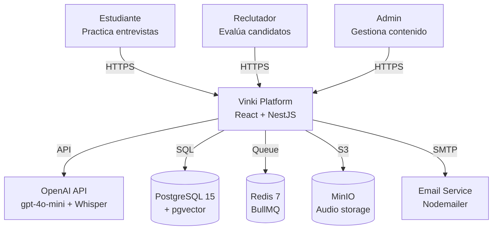
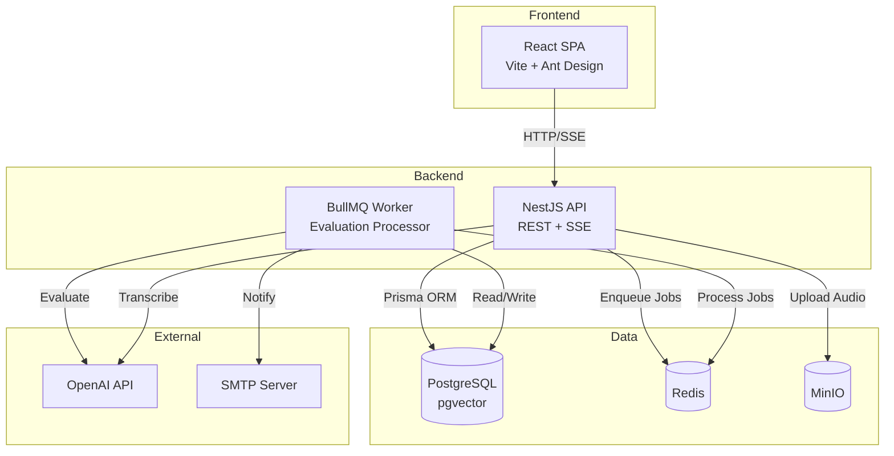
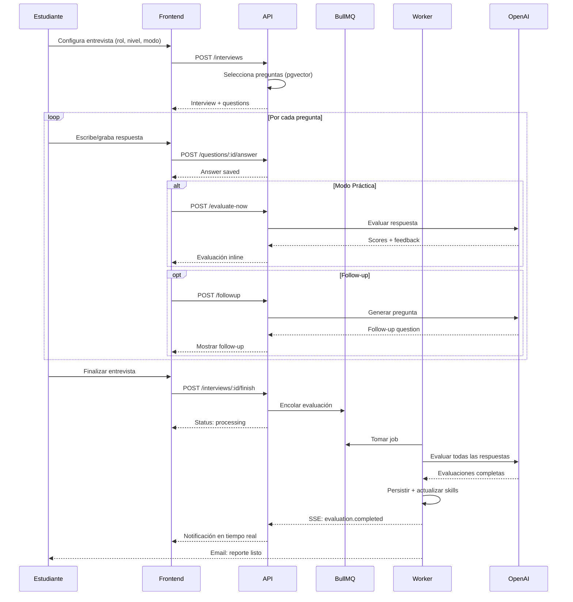
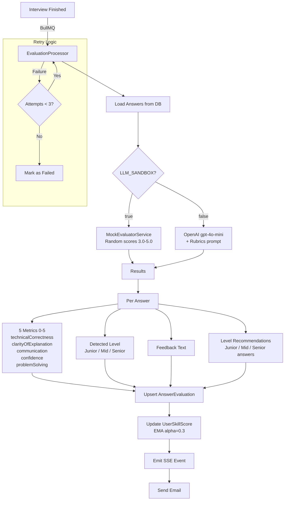
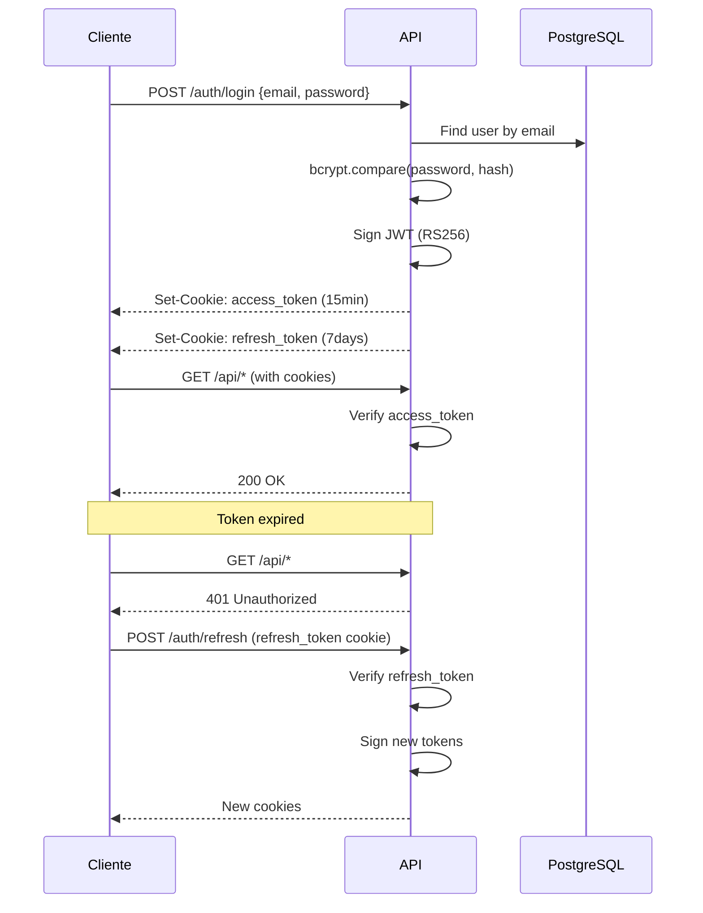

# Arquitectura de Vinki

## 1. Diagrama de Contexto (C4 Level 1)



## 2. Diagrama de Contenedores (C4 Level 2)



## 3. Flujo de Entrevista



## 4. Pipeline de Evaluación IA



## 5. Modelo de Datos

```mermaid
erDiagram
    User ||--o{ Interview : has
    User ||--o{ UserSkillScore : has
    User ||--o{ RecruiterNote : writes
    User ||--o{ AuditLog : generates

    Interview ||--o{ InterviewQuestion : contains
    Interview }o--|| Role : references
    Interview }o--|| Level : references
    Interview }o--o| Language : references
    Interview }o--o| Framework : references

    InterviewQuestion ||--o{ Answer : has
    InterviewQuestion }o--|| Question : snapshots

    Answer ||--o| AnswerEvaluation : evaluated_by
    AnswerEvaluation }o--o| Level : detected_level

    Question }o--|| Language : categorized_by
    Question }o--o| Framework : optional
    Question }o--|| Level : difficulty
    Question }o--|| Skill : tests

    Skill ||--o{ UserSkillScore : tracked_in

    User {
        int id PK
        string name
        string email UK
        string passwordHash
        enum role "student|recruiter|admin"
        datetime createdAt
    }

    Interview {
        int id PK
        int userId FK
        int roleId FK
        int chosenLevelId FK
        string mode "practice|evaluation"
        enum evaluationStatus "pending|processing|completed|failed"
        datetime startedAt
        datetime finishedAt
    }

    Question {
        int id PK
        string questionText
        string type
        int languageId FK
        int levelId FK
        int skillId FK
        vector embedding "1536 dim"
    }

    AnswerEvaluation {
        int id PK
        int answerId FK UK
        float technicalCorrectness
        float clarityOfExplanation
        float communication
        float confidence
        float problemSolving
        int detectedLevelId FK
        string feedbackText
        string juniorAnswer
        string midAnswer
        string seniorAnswer
    }

    UserSkillScore {
        int id PK
        int userId FK
        int skillId FK
        float score "0-100 EMA"
    }
```

## 6. Flujo de Autenticación


